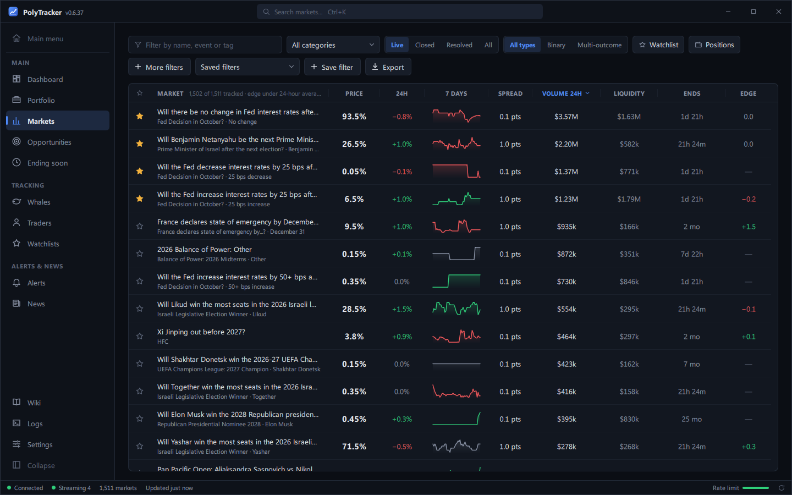
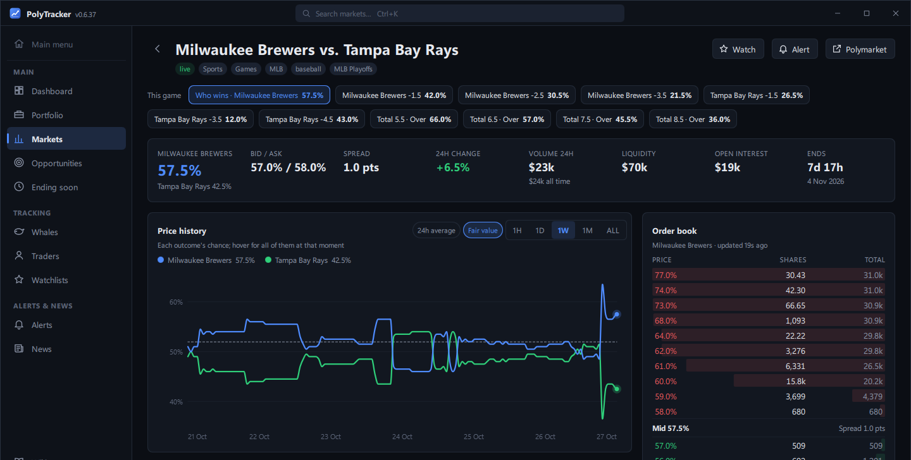
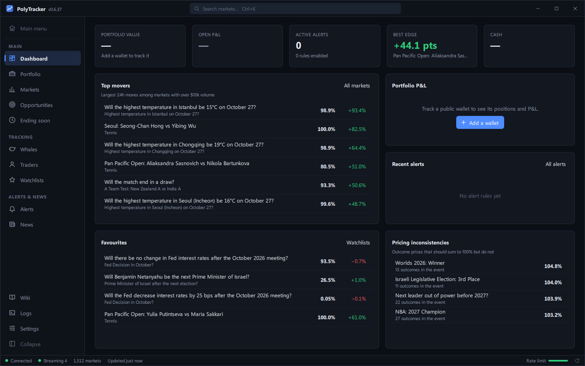
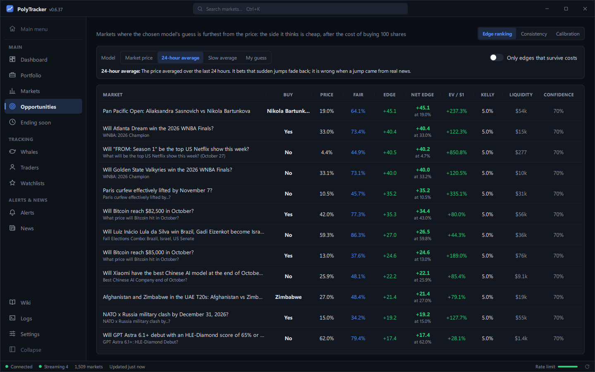
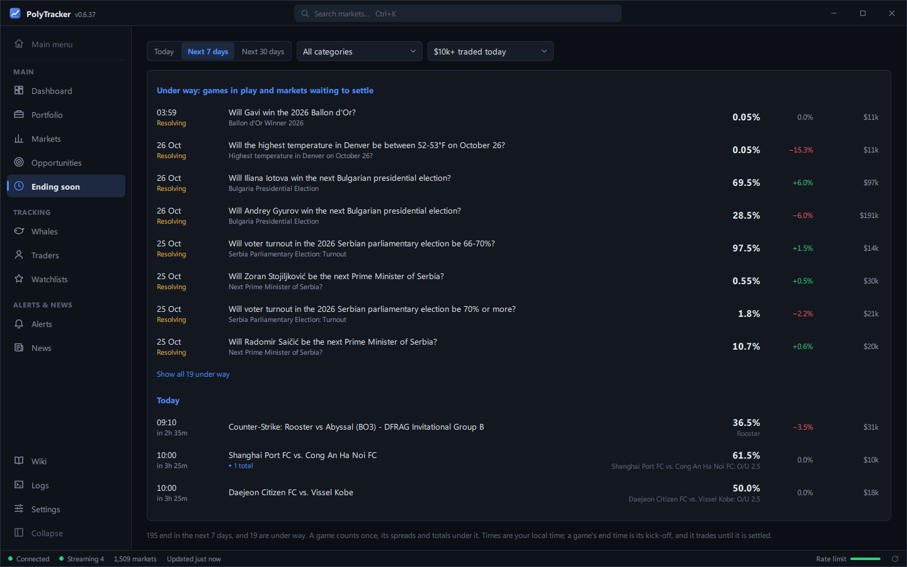
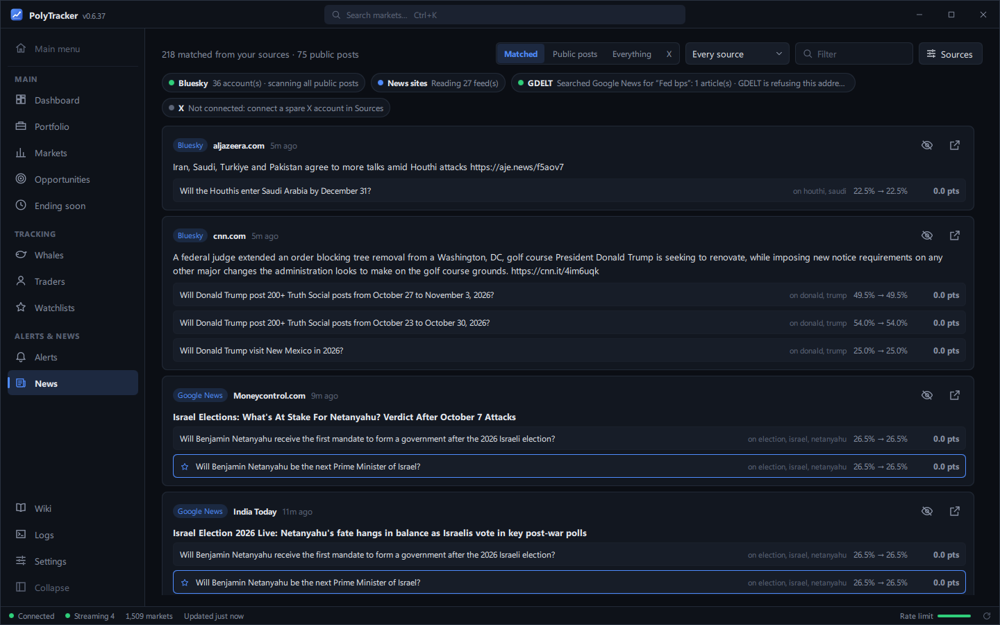
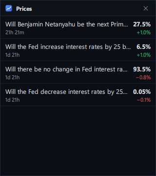
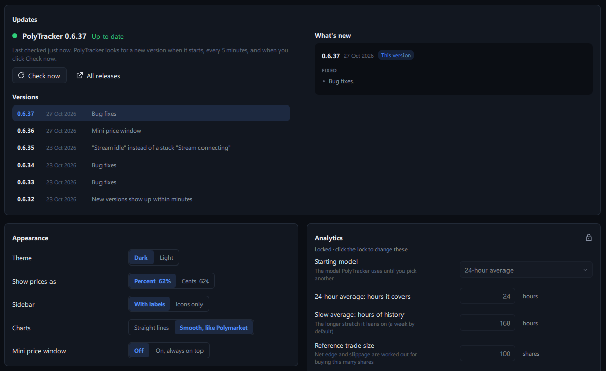

# PolyTracker

[](https://github.com/HarveyK1/PolyTracker-releases/stargazers)
[](https://github.com/HarveyK1/PolyTracker-releases/watchers)
[](https://github.com/HarveyK1/PolyTracker-releases/releases/latest)
[](https://github.com/HarveyK1/PolyTracker-releases/releases)
[](https://hits.sh/github.com/HarveyK1/PolyTracker-releases/)

A desktop tracker for [Polymarket](https://polymarket.com) prediction markets, for Windows and Linux. Live
prices and order books, games as they're played, your portfolio and P&L, top traders and whales, news
matched to markets, and alerts on your desktop or phone.

**It only reads public data.** It never asks for a private key, seed phrase or password, and it
can't place, cancel or sign trades.

### [⬇ Download the latest version](https://github.com/HarveyK1/PolyTracker-releases/releases/latest)

Under **Assets**, download `PolyTracker-Setup-<version>.exe`, then see [Install](#install). On Linux
(from version 0.6.40), download `PolyTracker-<version>-x86_64.AppImage` instead: see
[Install on Linux](#install-on-linux).



---

## What it does

### Every market, live

The 1,500 busiest markets in one table: price, 24-hour change, a week's sparkline, spread, volume,
liquidity, and when it ends. Sort it, filter it, and star the ones you care about. The markets you're
looking at, have starred or hold update the moment their price moves.

### Games as they happen

A game's page puts all of its markets side by side (who wins, every spread and total) and explains
each in plain words. The score and clock update live, and once it's over it says when a result has
been proposed or disputed. **Ending soon** lists what finishes today and this week, with each game
shown once.



### A second opinion on every price

Four ways of judging a price: the market itself, its 24-hour average, a slower week-long average, and
your own guess. For each, PolyTracker shows how far the price is from it, what that's worth per
dollar after the cost of buying, and a cautious bet size. **Opportunities** ranks the biggest gaps,
flags events whose prices add up to more than 100%, and keeps score of which approach has been right.

| | |
|---|---|
|  |  |

### Wallets, traders and whales

- **Portfolio:** any public wallet's positions, P&L over time, what it's exposed to, a P&L calendar,
  and a warning when two bets on one game work against each other.
- **Traders:** look anyone up by name or wallet for their win rate, biggest wins and losses, open
  bets and trade history. Star your favourites, or browse the top traders.
- **Whales:** the biggest trades on Polymarket as they happen. A bot's order that fills in many
  pieces shows as one bet with its total.

### News that moves markets

A live feed from Bluesky, 27 news sites and Google News, each story matched to the markets it's about,
with how much the price has moved since. Every market's page shows its own related news. X can be
added with a spare account.

| | |
|---|---|
|  |  |

### Alerts, and a price window that stays on top

- **Alerts** for price targets, sharp moves, big trades, news, markets ending or settling, your P&L,
  and traders you follow, on your desktop or your phone through Discord or Telegram.
- **Mini price window:** a small window that stays above everything else, with the live prices of the
  markets you hold and have starred, so you can follow a game while doing something else. Turn it on
  in **Settings → Appearance**.

<p>
  
  
</p>

### And more

Export to CSV or JSON, Ctrl+P to jump anywhere, dark and light themes, prices in percent or cents,
and a full guide built in (**Wiki**, bottom left).

---

## Install

1. Run the `PolyTracker-Setup-<version>.exe` you downloaded.
2. Windows may warn you, because PolyTracker isn't signed with a paid certificate. On *Windows
   protected your PC*, click **More info**, then **Run anyway**.
3. Follow the wizard: choose whether you want a desktop shortcut, then click **Install**.
4. Leave **Launch PolyTracker** ticked on the last page to open it. It's also in your Start menu.

It installs just for you, in `%LOCALAPPDATA%\Programs\PolyTracker`, and needs no administrator
rights. Everything it needs comes with it. You can delete the downloaded Setup afterwards.

**Needs:** Windows 10 or 11 (64-bit). For Linux, see [Install on Linux](#install-on-linux).

This page holds the released versions only. Only the newest can be downloaded: older releases keep
their notes, so you can see what changed, but not their Setups.

## Install on Linux

From version 0.6.40. PolyTracker for Linux is one file, an AppImage, with everything it needs inside:
nothing is installed.

1. Download `PolyTracker-<version>-x86_64.AppImage` from the latest release.
2. Make it executable: right-click it, **Properties**, then tick **Allow executing as program** (or
   **Is executable**), or run `chmod +x PolyTracker-*.AppImage`.
3. Double-click it. Keep it somewhere of your own, such as your home folder or `~/Applications`, so it
   can update itself.

Your data is kept in `~/.local/share/PolyTracker` and your settings in `~/.config/PolyTracker`.

**What your Linux needs.** A normal desktop install (Ubuntu, Fedora, Mint, CachyOS with KDE or
GNOME) already has everything. A minimal install may need some of these:

| For | Needed | Ubuntu / Debian | Fedora | Arch / CachyOS |
|---|---|---|---|---|
| Starting at all | FUSE (or start it with `--appimage-extract-and-run`) | `fuse3` | `fuse3` | `fuse3` |
| The window, on Wayland | XWayland | `xwayland` | `xorg-x11-server-Xwayland` | `xorg-xwayland` |
| The window, if it says it "could not load the Qt platform plugin xcb" | xcb-cursor | `libxcb-cursor0` | `xcb-util-cursor` | `xcb-util-cursor` |
| X news | Python 3 | `python3` | `python3` | `python` |
| X sign-in and phone alerts | a keyring (KDE Wallet on KDE) | `gnome-keyring` | `gnome-keyring` | `gnome-keyring` |
| Desktop pop-ups on plain GNOME | a tray | `gnome-shell-extension-appindicator` | `gnome-shell-extension-appindicator` | `gnome-shell-extension-appindicator` |

Install them with `sudo apt install …`, `sudo dnf install …` or `sudo pacman -S …`. Without the
last three, everything else still works. It needs a system from about 2022 or later; older ones,
such as Ubuntu 20.04 or Debian 11, can't start it.

**Uninstall:** delete the AppImage, and the two folders above if you don't want to keep your data.

## Updates

PolyTracker looks for a new version when it starts and every 5 minutes. When one is out,
**Update to …** appears at the bottom right of the window. Click it to see what's new, then
**Update now**. PolyTracker downloads the new version, checks it, closes, installs it with just a
progress bar, and reopens. Your data and settings are kept. On Linux, the new AppImage replaces the
old one in the same place.

**Settings → Updates** shows your version, every recent version's notes, and **Check now**.

## Uninstall

**Settings → Apps → Installed apps → PolyTracker → Uninstall**. It asks whether to delete your
data too (watchlists, followed wallets, alert rules, settings, and saved sign-ins). If you keep it,
it's there if you install PolyTracker again.

## Privacy and safety

- **Read-only:** it reads Polymarket's public data and public wallet activity. Wallet addresses and
  positions on Polymarket are public; tracking one only reads what anyone can see on polymarket.com.
- **Your data stays on your PC,** in `%LOCALAPPDATA%\PolyTracker` (on Linux,
  `~/.local/share/PolyTracker`). There's no account, and nothing about what you do in the app is sent
  anywhere.
- **What it connects to:**
  - Polymarket, for markets and wallets
  - the news sources you turn on
  - a public Polygon node, for a wallet's cash balance
  - GitHub (this page), to look for updates
  - once a day, an anonymous count that a copy is in use: a random id it made for itself, its
    version and the system's name, such as "Windows 11" (no names, wallets or IP addresses are kept)
  - X, Discord and Telegram, only if you connect them yourself (those sign-ins and keys are kept in
    Windows Credential Manager, or on Linux in your keyring)
- **Not financial advice:** estimates, "edges" and suggested sizes are calculations from public
  prices, not recommendations.

## Checking a download

Each release lists the Setup's SHA-256 checksum, and has a `.sha256` file beside it. PolyTracker's
updater checks this itself. To check a Setup you downloaded by hand, run this in PowerShell and
compare the result:

```powershell
Get-FileHash .\PolyTracker-Setup-<version>.exe -Algorithm SHA256
```

## Help

PolyTracker has a full guide built in: open **Wiki** at the bottom left. If something goes wrong,
**Logs → Export logs** saves a log file you can send along with a description of the problem.
